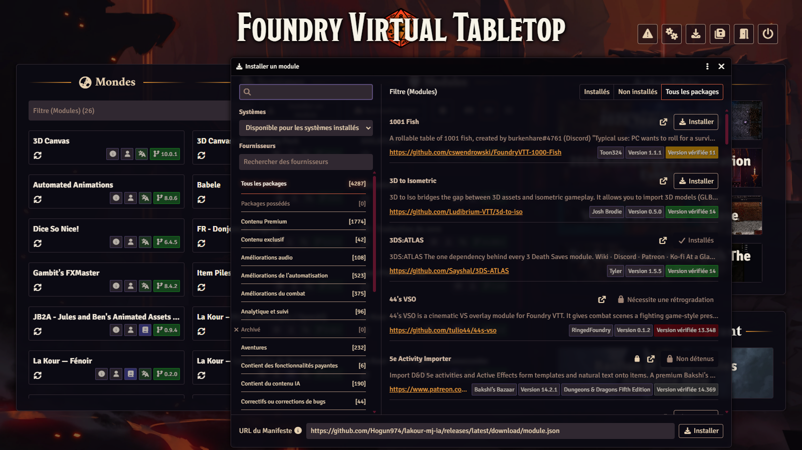
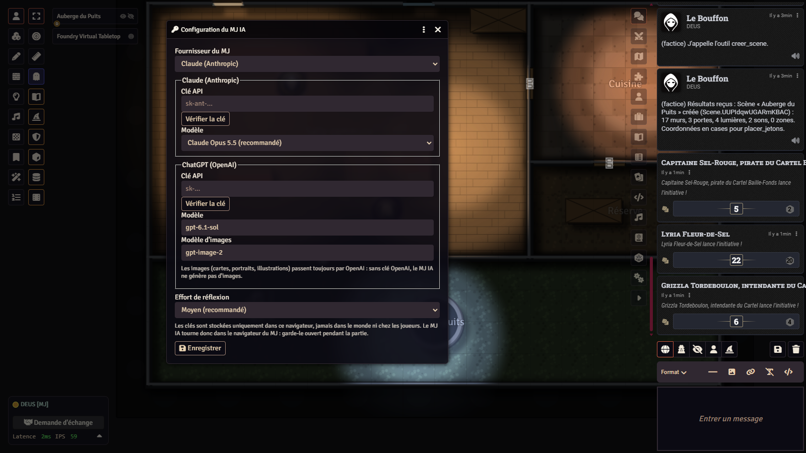
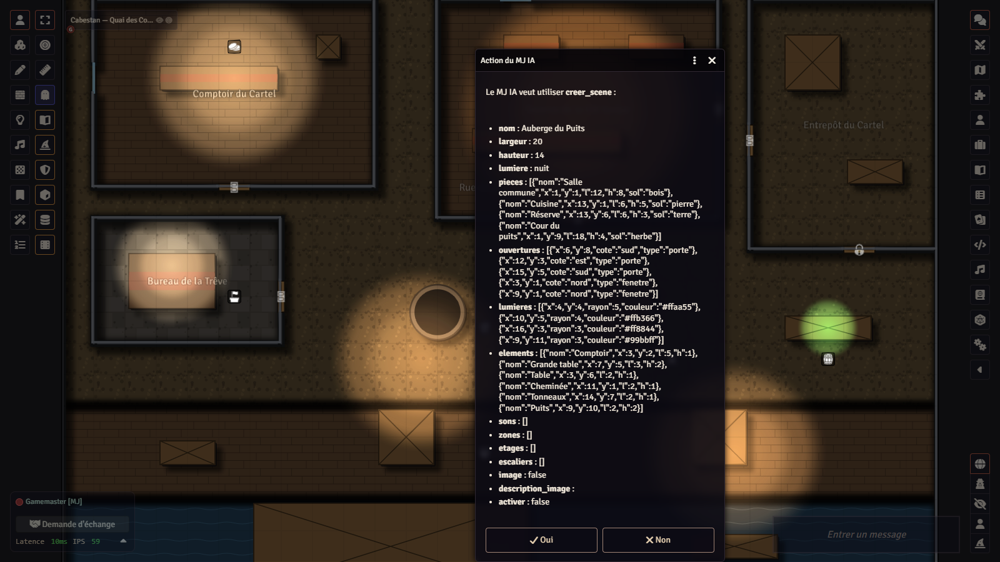
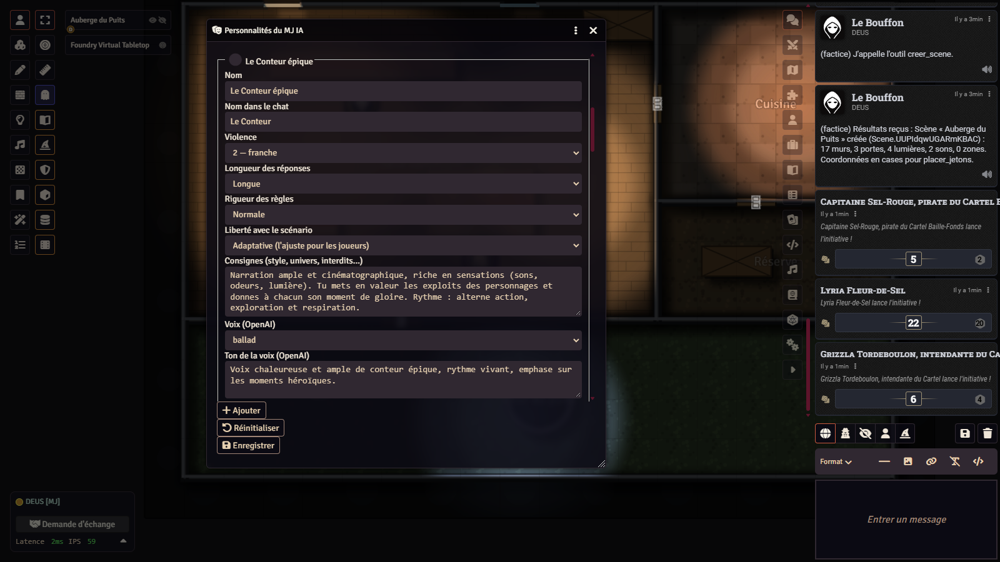
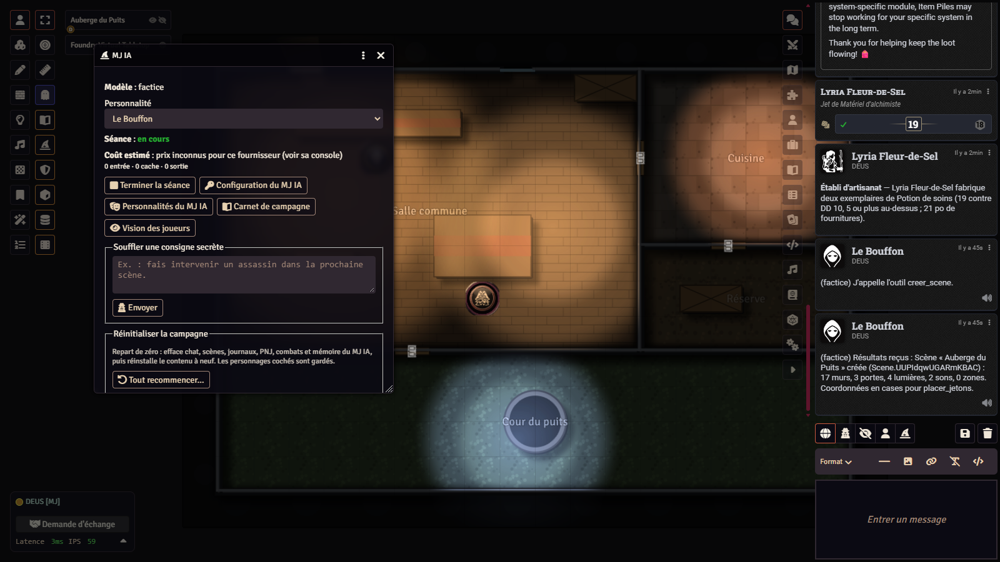
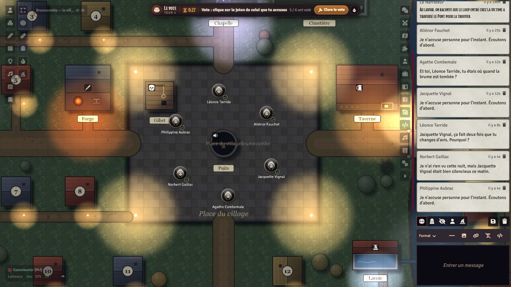
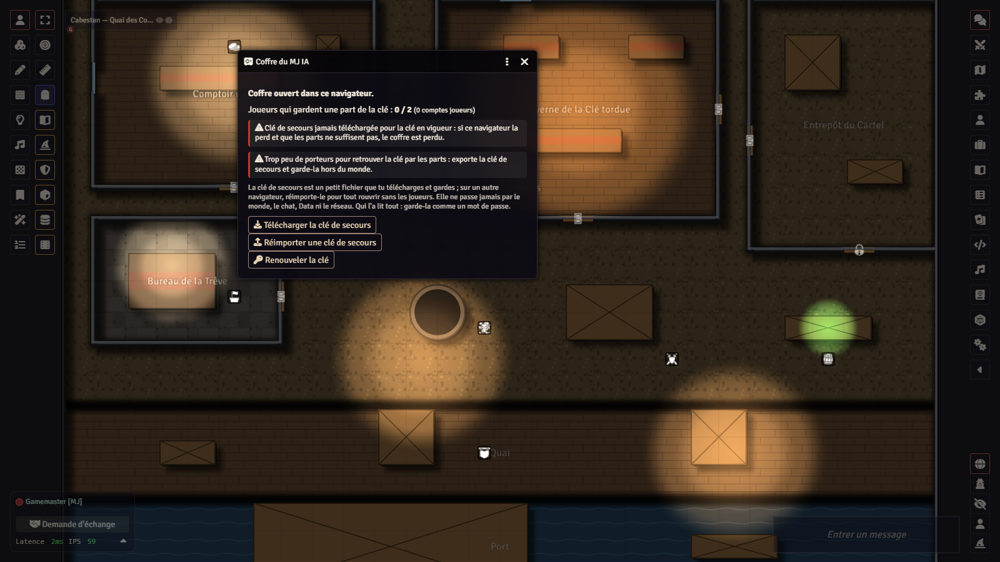

# Tutorial — from zero to your first session with the AI GM

*Version française : [TUTORIEL.md](TUTORIEL.md).*

This tutorial is for a game master (GM) who is new to **La Kour – MJ IA** (`lakour-mj-ia`), a Foundry VTT module that
lets an AI (Claude or ChatGPT) take the narrator's chair, using **your own API key**. It goes from installation to the
end of your first session. Allow half an hour, free trial included.

Every feature is detailed in the full guide: [`docs/guide-utilisation.en.md`](docs/guide-utilisation.en.md). The same
guide is installed in every English world, as two journals: "MJ IA — GM's Guide" and "MJ IA — Players' Guide".

> "MJ IA" is French for "AI GM". The project is French-speaking: some labels below (for instance the *Factice* provider)
> stay in French even in an English interface.

## Contents

1. [What you need](#1-what-you-need)
2. [Install the module](#2-install-the-module)
3. [Pick a world](#3-pick-a-world)
4. [Enable the module in the world](#4-enable-the-module-in-the-world)
5. [Set the provider and the key](#5-set-the-provider-and-the-key)
6. [Budget and cost](#6-budget-and-cost)
7. [Autonomy: approval or autonomous](#7-autonomy-approval-or-autonomous)
8. [Personalities](#8-personalities)
9. [The console](#9-the-console)
10. [A free trial with the dummy provider](#10-a-free-trial-with-the-dummy-provider)
11. [First session, step by step](#11-first-session-step-by-step)
12. [AI companions](#12-ai-companions)
13. [Voice (optional)](#13-voice-optional)
14. [The vault's backup key](#14-the-vaults-backup-key)
15. [Updating](#15-updating)
16. [Troubleshooting](#16-troubleshooting)
17. [Uninstalling](#17-uninstalling)

## 1. What you need

- **Foundry VTT version 14** (tested with 14.370), with its licence. The module does not work on v13.
- **A recent browser for the GM**: up-to-date Chrome, Edge or Firefox. This browser is the one that talks to the AI: it
  must stay open during the game.
- **An account with an AI provider, with credit and an API key.** The module supports two:
  - **Anthropic** (Claude models): account and key at [console.anthropic.com](https://console.anthropic.com);
  - **OpenAI** (ChatGPT models): account and key at [platform.openai.com](https://platform.openai.com).

  One is enough for text. **OpenAI voice**, **listening** to players and **images** always go through OpenAI: they need
  an OpenAI key, whatever the text provider.
- **Nothing at all to try it out**: the **dummy** provider (*Factice*) answers with no network, no key and no cost
  (section 10).

Tip: create a **dedicated key** for the AI GM and set a **spending cap** at the provider. The module's budget (section 6)
is only an estimate; the provider's cap is a real limit.

## 2. Install the module

1. Open Foundry's setup screen (the one listing the worlds).
2. **Add-on Modules** tab › **Install Module**.
3. At the bottom of the window, in the **Manifest URL** field, paste:

   ```
   https://github.com/Hogun974/lakour-mj-ia/releases/latest/download/module.json
   ```

4. Click **Install**. The module appears in the list: *La Kour – MJ IA (Anthropic / OpenAI)*.



Without the manifest, you can also download the archive by hand:
`https://github.com/Hogun974/lakour-mj-ia/releases/latest/download/lakour-mj-ia.zip`, and unzip it into
`Data/modules/lakour-mj-ia/` in your Foundry data folder.

## 3. Pick a world

The AI GM works in **any** Foundry v14 world. In a system without a dedicated adapter it runs in **generic mode**: it
narrates, creates maps and journals, starts ambient sounds, runs votes and secret choices, keeps its memory; it asks
players to roll their own dice.

It is at its best in the La Kour worlds, built for it, each with its own manual and a ready-to-play blank world:

| World | System | Repository (installation and manual) |
|---|---|---|
| **La Kour Warcraft** — Azeroth for D&D 5e (2024 rules) | `dnd5e` | [github.com/Hogun974/lakour-warcraft](https://github.com/Hogun974/lakour-warcraft) |
| **The Vigils of Brumecombe** (*Les Veillées de Brumecombe*) — an original werewolf game, social deduction | `lakour-loups` (provided) | [github.com/Hogun974/lakour-veillees](https://github.com/Hogun974/lakour-veillees) |
| **Fénoir** — survival on Réunion Island on day zero of an epidemic | `lakour-survie` (provided) | [github.com/Hogun974/lakour-fenoir](https://github.com/Hogun974/lakour-fenoir) |

Follow the README of the world you choose: it says which system and content module to install, and in what order. Each
world has an English content module (`-en`).

## 4. Enable the module in the world

1. Launch the world and log in with the **Gamemaster** account.
2. **Before inviting anyone**, set a password on the Gamemaster account and on every player account (**Game Settings** ›
   **User Management**). A new world has a GM account without a password: any guest could log in with it. The module's
   vault (section 14) protects nothing without passwords.
3. **Game Settings** tab (cog) › **Manage Modules**.
4. Tick **La Kour – MJ IA**, then **Save Module Settings**. The page reloads.

On first load, the module installs its guide in the world: "MJ IA — GM's Guide" (hidden from players) and "MJ IA —
Players' Guide" (the French versions in a French world). The module does not ask for a key by itself: that is the next
step.

## 5. Set the provider and the key

1. **Game Settings** › **Configure Settings** › the **La Kour – MJ IA** section › **Configure** button ("AI GM
   configuration" window). The same button is in the console (section 9).
2. **GM provider**: *Claude (Anthropic)*, *ChatGPT (OpenAI)* or *Factice (essais, gratuit)* (the free dummy provider).
3. In the block of the chosen provider, paste your key in **API key**, then click **Check key**. The check costs
   nothing: it lists the models you can use ("Valid key: N models available").
4. **Model**:
   - Anthropic: a list — *Claude Opus 5.5* (recommended, the default), *Claude Sonnet 5.5* (cheaper), *Claude Haiku 5.5*
     (very cheap), *Claude Fable 5.1* (the most powerful, the most expensive);
   - OpenAI: a free field (`gpt-6.1-sol` by default), and an **Image model** (`gpt-image-2`).
5. **Reasoning effort**: *Medium (recommended)* by default. Higher means the AI thinks more, more slowly and at a higher
   cost.
6. **Save**.



### Where the key is stored, and who can see it

- Keys are Foundry settings of **client** scope (`scripts/reglages.js`): they are stored in **this browser only** (its
  `localStorage`), never in the world.
- So they go **neither to the players, nor into the chat, nor to the Foundry server, nor into the `Data/` files**. The
  module's author does not see them either: there is no intermediate server. The GM's browser calls
  `api.anthropic.com` or `api.openai.com` directly.
- Once saved, the key is never shown again: the field reads "•••• key saved". Leave the field empty to keep it; tick
  **Erase the saved key** to remove it.
- **Who can read it**: anyone using that same browser (same OS session, an extension, another Foundry account opened on
  that machine). One browser per person; revoke the key at the provider at the slightest doubt.
- On another browser or another computer, you have to type it again.

## 6. Budget and cost

Calls are billed **by the provider, to your account**, at its rates.

- **Budget per session (dollars)** (*Game Settings › Configure Settings › La Kour – MJ IA*): **$10** by default. When
  the session's estimated cost reaches it, the AI GM stops and tells you. 0 = no limit. The budget counts everything:
  narrator, companions, voice, transcription.
- **Estimated cost**: shown in the console. It uses the prices listed in `scripts/constantes.js` (with their date); the
  provider's invoice is what counts.
- **Careful**: for an OpenAI model whose price the module does not know, the console shows "prices unknown" and the
  budget cannot count that model. Only the cap set at the provider protects you then.
- **Order of magnitude** seen at the table: from a few tens of cents to a few dollars per session, depending on the
  model, the effort and the length. OpenAI voice costs about 2 to 3 cents per minute.
- To spend less: *Claude Sonnet 5.5* or *Haiku 5.5*, *Low* effort, browser voice (free).

## 7. Autonomy: approval or autonomous

Setting **AI GM autonomy** (*Configure Settings › La Kour – MJ IA*):

- **Human GM approval** (the default): every action that changes the world or costs money (creating an NPC, a journal, a
  map, an image, placing tokens, eliminating, changing an item…) opens an **"AI GM action"** window on your screen that
  sums it up. You accept or refuse. A refusal does not stop the game: the AI goes on without that action.
- **Autonomous**: the AI acts without asking. It is also the only mode in which the **autopilot** can move a game forward
  when only AI companions are left (section 12).

Keep **approval** for your first sessions and for a table you do not know.



## 8. Personalities

A personality says **how** the AI runs the game: tone, violence (1 to 3), answer length, rules strictness, freedom with
the scenario (*faithful*, *adaptive*, *free*), voice, and free-form instructions.

- To edit them: **Configure Settings** › La Kour – MJ IA › **AI GM personalities** › **Edit**, or the button of the same
  name in the console.
- Seven personalities are shipped, to keep, edit or copy:

| Personality | For what |
|---|---|
| **The Storyteller** (*Le Conteur épique*) | Heroic adventure, sweeping narration: a good pick for Warcraft. |
| **The Voice of the Mist** (*La Voix de la brume*) | A fireside storyteller, made for the Vigils of Brumecombe and secret-role games. |
| **Gramoune** (*La Gramoune*) | A survival narrator from Réunion Island, made for Fénoir. |
| **The Inquisitor** | Dark, relentless, strict rules. |
| **The Arbiter** | Concise, rules as written, clear positions. |
| **The Chronicler** | Intrigue, dialogue, story before rules. |
| **The Jester** | Light and funny. |

- You pick one in the console. A change applies **from the next session start**.



## 9. The console

The console is for the GM only: the **wizard hat** button in the left toolbar, under **Token Controls**.



What it holds:

- the current **Personality** and **Model**;
- **Start session** / **End session**: the AI only answers **during a session**;
- the session's **Estimated cost** (and *Companions outside a session* in the Vigils);
- **Whisper a secret instruction**: an instruction only you and the AI see ("have an assassin show up in the next
  scene");
- **Prepare a scenario**: give a theme, the AI creates journals, NPCs and maps, outside a session;
- **Create a character with the GM**: the AI guides a player in the chat and creates their sheet (D&D 5e, Imperium
  Maledictum, Fénoir);
- **Player vision**: fixes the characters' vision if players see only black on a map;
- **AI GM configuration**, **AI GM personalities**, **Campaign notebook** (depending on the world);
- **Reset the campaign** (*Start over…*): erases chat, scenes, journals, NPCs and the AI GM's memory. Do not click it by
  mistake: it cannot be undone from Foundry.

## 10. A free trial with the dummy provider

Before spending anything, check that everything works:

1. **AI GM configuration** › GM provider: **Factice (essais, gratuit)** › Save.
2. Console › **Start session**.
3. Type in the chat: `Hello`. A few seconds later the dummy answers "(factice) Le MJ a bien reçu…" ("the GM got it").
4. Try a tool, for instance a group vote:

   ```
   !outil vote_groupe {"question":"Shall we go in?","options":["Yes","No"]}
   ```

   A vote window opens for the connected players. In approval mode, sensitive tools first open the "AI GM action"
   window on your screen.
5. Console › **End session**.

No network call, no cost. Then switch back to your real provider.

## 11. First session, step by step

**Before the session**

1. Check the account **passwords** (section 4).
2. Every player has a character. If not: console › **Create a character with the GM** (D&D 5e, Imperium Maledictum,
   Fénoir), or create the sheet yourself. A connected player without a character is also offered a creation.
3. Choose what the AI will run: the world's adventure (in the La Kour worlds, imported from the **Adventures** compendium
   or offered when the world is created), a scenario you wrote in a journal, or console › **Prepare a scenario** with a
   theme.
4. Activate a scene with the characters' tokens, or let the AI create the map at the start.
5. Check the **provider**, the **budget** and the **autonomy** (approval).

**During the session**

6. Console › pick the **personality** › **Start session**.
7. Players write in the chat, as at a table: what their character does, what they say. The AI GM answers a few seconds
   after they stop writing (setting **Delay before answering**, 6 s by default).
8. It places tokens on the map before narrating, starts ambient sounds, plays the NPCs. When it asks for a roll, the
   dialog opens on the player's screen, already set up: the player checks it and rolls.
9. In approval mode, **accept or refuse** each "AI GM action" window.
10. To steer the story without the players seeing it: **Whisper a secret instruction**.
11. Keep an eye on the **estimated cost**.

**At the end**

12. Console › **End session**. The AI awards experience, writes the **chronicle** for the players and updates its
    **campaign memory**: a GM-only journal. Read it and correct it if needed: the AI rereads it at the start of every
    session.

A session left open when the GM leaves the page is stopped when they come back. The conversation with the AI is kept
(encrypted) from one session to the next: the AI picks up where it left off.

The AI answers in the world's language: English when the world's English content module (`-en`) is active, or, with no
content module, when Foundry's interface is in English. Its internal instructions stay in French.

## 12. AI companions

Characters **on the players' side**, played by the AI as players, to fill a table. Each one makes its own model call
and only knows what its character knows: its sheet, the public chat, what it was told privately.

- **Warcraft** (and the other systems whose sheets the AI GM writes): during a session, ask "add a companion to the
  party". The AI GM creates its sheet, temperament and backstory, and places its token near the party. It reacts to
  narrations, acts on its turn in combat, votes.
- **Vigils of Brumecombe**: ask the AI GM for a game "with 3 companions", or, without an AI GM session, use the
  **+ AI player** button of the **Game table**.
- **Removing them**: "Varn leaves us" (the token goes) or "Varn stays in the village" (it becomes an NPC).
- **Settings**: *AI companions model* (empty = a cheap model: Claude Haiku 5.5, or OpenAI's cheapest) and *AI
  companions chattiness* (silent, discreet, normal, chatty).
- **Cost**: one short call per line or decision, counted in the budget. With no key, the budget reached or the dummy
  provider, they play in simple mode, without AI.
- **Autopilot**: in **Autonomous** mode, if only AI companions are left, the game goes on by itself, step by step, and
  stops at victory, at the budget, when a player comes back, or on **Stop the autopilot** in the console.



Details (in French): [`docs/compagnons.md`](docs/compagnons.md).

## 13. Voice (optional)

Setting **Narrator voice** (*Configure Settings › La Kour – MJ IA*):

- **None**;
- **Browser voice (free)**, the default: each player hears the narration with a voice from their own computer;
- **OpenAI voice (paid, broadcast to all)**: a realistic live voice, one voice per companion. It needs an OpenAI key
  (about 2 to 3 cents per minute, counted in the budget).

Each player sets **Hear the AI voices** and **AI voice volume** on their own machine.

**Listening** (optional too): the AI can hear what players say in Foundry's built-in voice chat.

1. **Game Settings** › **Configure Audio/Video**: **Audio only** mode. The console also offers an **Enable audio**
   button.
2. Setting **Listen to players' speech (transcription)** ticked (it is by default).
3. It needs an OpenAI key. Listening only runs during a session or with a living AI companion; an "AI is listening" badge
   then shows on everyone's screen. A muted microphone sends nothing.

Details (in French): [`docs/voix-et-ecoute.md`](docs/voix-et-ecoute.md).

## 14. The vault's backup key

Foundry sends every world document and setting to **every connected browser**: a curious player can read, in their
browser console, what the interface hides from them. The module's **vault** encrypts what must stay secret: the hidden
entries of the campaign notebook, the conversation with the AI and, in the Vigils, the roles.

- The vault key stays in **your browser**. Outside the Vigils, each player keeps a **share** of it; a majority is needed
  to rebuild it.
- **In the Vigils**, no share is given to the players (two wolves could pool theirs). The backup key is then the
  **only** way to recover the key if your browser loses it.

**Download the backup key during your first session:**

1. **Configure Settings** › La Kour – MJ IA › **MJ IA vault** › **Open the vault**.
2. **Download the backup key**. You get a small file `cle-de-secours-<world>-<date>.json`.
3. Keep it **outside the world**, like a password (password manager, USB stick). Never put it in `Data/` or in the chat.
4. On a new browser: same window › **Import a backup key**.

Until it is downloaded, the module reminds you on every world load.



What the vault does not protect: the campaign memory, the GM journals (scenarios, notes), the "what they keep to
themselves" pages of backstories. Those are protected by Foundry's ownership rights only.

## 15. Updating

1. **Back up** your Foundry data folder (at least the world's folder, in `Data/worlds/`).
2. Foundry's setup screen › **Add-on Modules** › the update button on the module's line, or **Update All**. The manifest
   URL always follows the latest version.
3. Relaunch the world (or press **F5** if the world was open).
4. The guide installed in the world updates itself. What changed: [`CHANGELOG.md`](CHANGELOG.md) (in French).

## 16. Troubleshooting

| What you see | What to do |
|---|---|
| No wizard hat | Log in as GM, check that the module is ticked in **Manage Modules**, select the token controls. |
| "No API key for this provider" | The key is not in **this** browser: open **AI GM configuration** and paste it. |
| The AI does not answer | Is the session started? Is the budget reached? Is the key valid (**Check key**)? Is the GM's browser open? A single player only triggers one answer every 10 s (setting **Pace per player**). |
| A provider error (key refused, credit exhausted, too many requests) | Check your account and billing at Anthropic or OpenAI. |
| "Session budget reached" | Raise **Budget per session**, or end the session. |
| A player sees only black on the map | Console › **Player vision**. |
| No voice | Is **Narrator voice** set to something other than *None*? Did the player tick **Hear the AI voices**? OpenAI voice: is an OpenAI key saved? |
| A banner says the vault is locked in this browser | New browser: import the backup key (section 14), or let the players connect so they hand back their shares. |
| A D&D 5e dialog opens during a character creation | The system refused one of the AI's choices: finish the sheet by hand. |
| An update does not show | **F5**. A compendium update needs the world to be relaunched. |

To report a bug: [open an issue](https://github.com/Hogun974/lakour-mj-ia/issues) with the versions of Foundry, the
system, the module and the provider, and the errors from the browser console (**F12**, lines starting with
`lakour-mj-ia |`). **Never paste your key.**

## 17. Uninstalling

1. **Erase the key** in every browser where you typed it: **AI GM configuration** › tick **Erase the saved key** ›
   Save. If needed, revoke it at the provider.
2. In the world: **Manage Modules** › untick **La Kour – MJ IA** › Save.
3. Foundry's setup screen › **Add-on Modules** › delete the module (bin icon).

What remains after uninstalling, to delete by hand if you wish:

- in the world: the journals it created (AI GM guides, campaign memory, chronicles, backstories, scenarios), the scenes
  and NPCs created by the AI;
- in your Foundry data: the `Data/lakour-mj-ia/` folder (encrypted conversations and files created in play).

**In the Vigils of Brumecombe**, the module is required even without AI: it keeps the game's secrets. Do not uninstall
it from a Vigils world with a game in progress.

## Going further

- The full guide: [`docs/guide-utilisation.en.md`](docs/guide-utilisation.en.md).
- What is sent to the provider, security, privacy: [`README.en.md`](README.en.md).
- Turn by turn (in French): [`docs/tour-par-tour.md`](docs/tour-par-tour.md).
- The worlds: [Warcraft](https://github.com/Hogun974/lakour-warcraft),
  [Vigils of Brumecombe](https://github.com/Hogun974/lakour-veillees), [Fénoir](https://github.com/Hogun974/lakour-fenoir).
