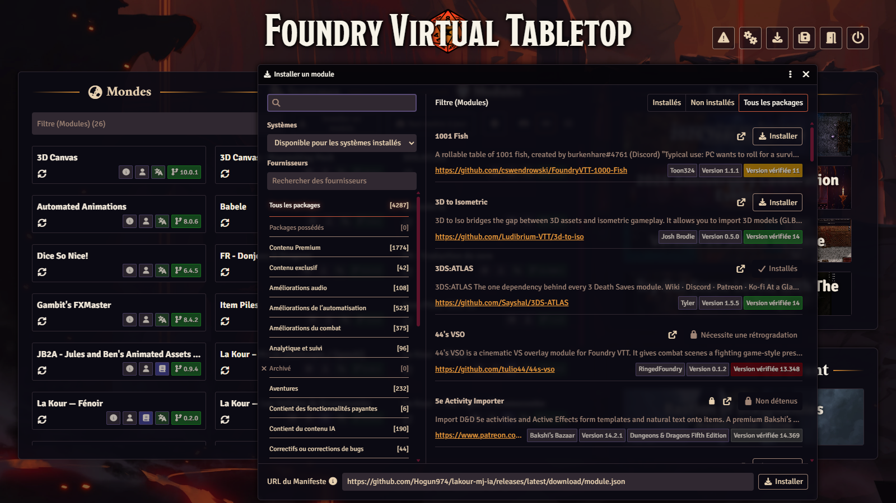
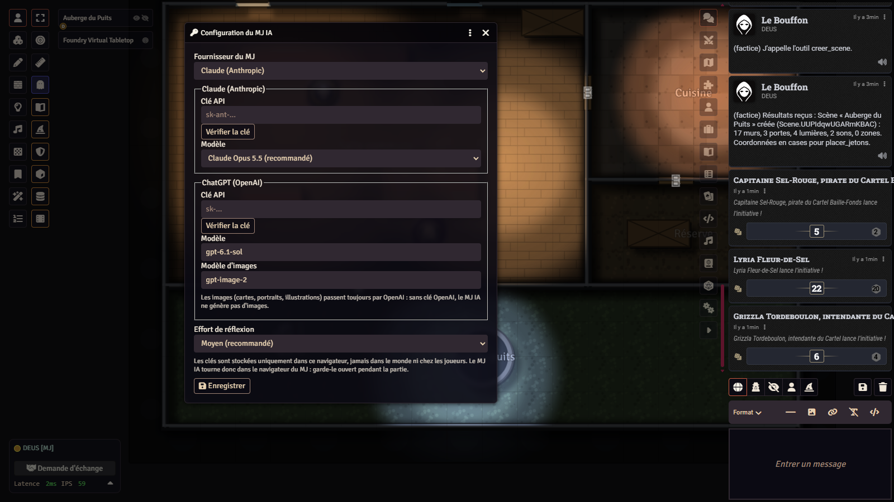
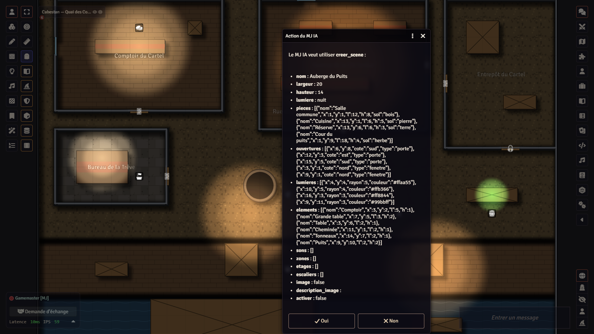
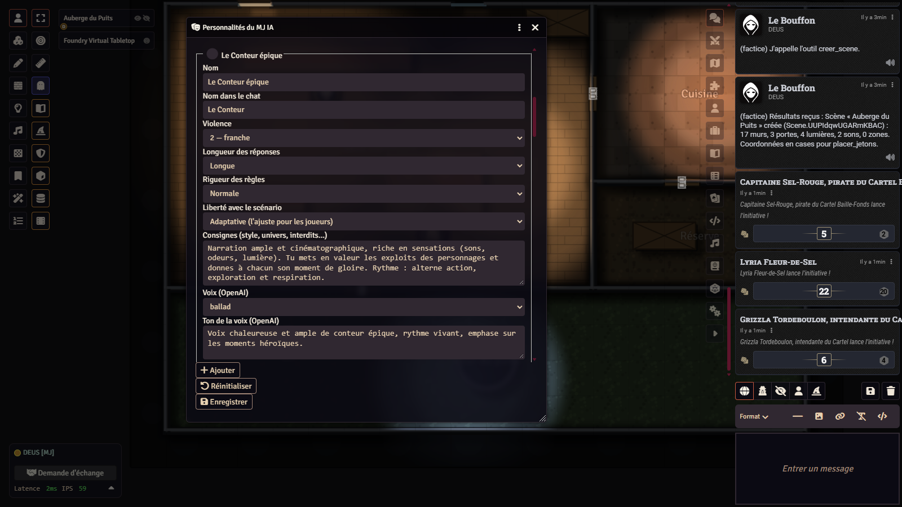
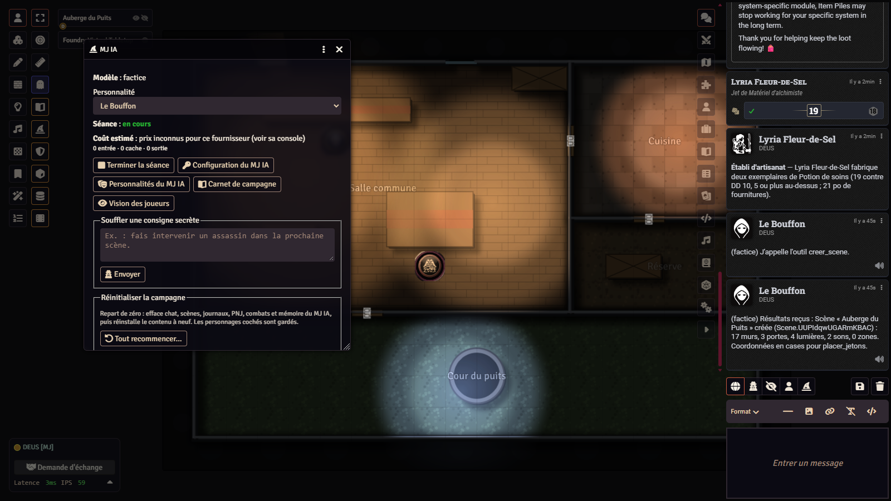
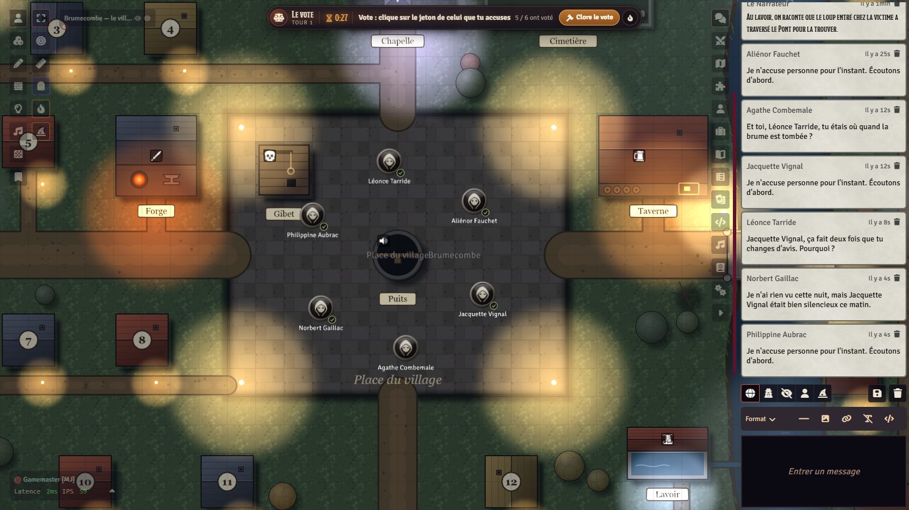
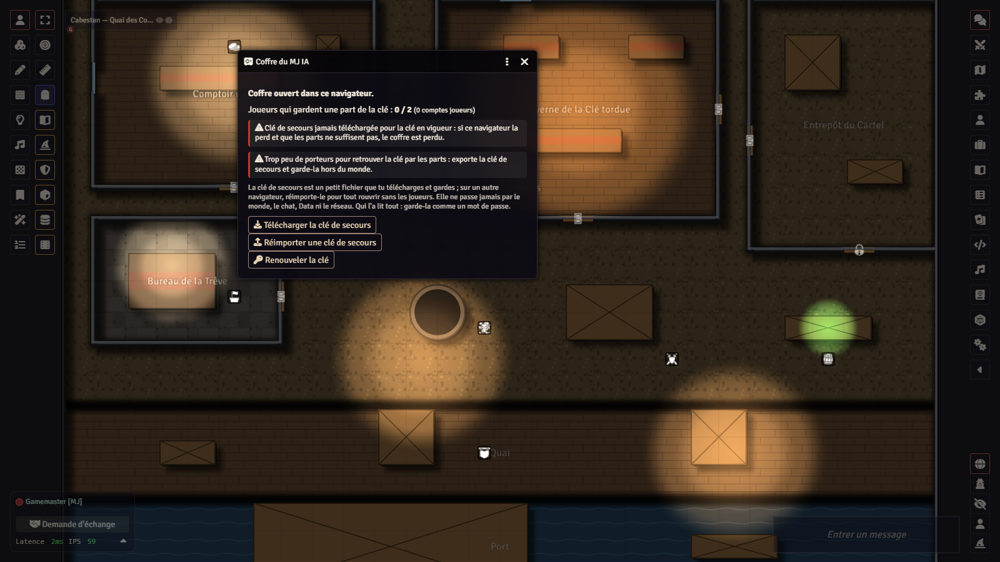

# Tutoriel — de zéro à la première séance avec le MJ IA

*English version: [TUTORIAL.md](TUTORIAL.md).*

Ce tutoriel s'adresse à un meneur de jeu (MJ) qui découvre **La Kour – MJ IA** (`lakour-mj-ia`), un module pour
Foundry VTT qui fait tenir le rôle du narrateur par une IA (Claude ou ChatGPT), avec **votre propre clé d'API**. Il va
de l'installation à la fin de votre première séance. Comptez une demi-heure, essai gratuit compris.

Le détail de chaque fonction est dans le guide complet : [`docs/guide-utilisation.md`](docs/guide-utilisation.md).
Le même guide est installé dans chaque monde, en deux journaux : « MJ IA — Guide du MJ » et « MJ IA — Guide des joueurs ».

> Les noms des menus de Foundry sont donnés en français, avec le nom anglais entre parenthèses la première fois :
> l'interface de Foundry est en anglais tant qu'aucun module de traduction n'est actif.

## Sommaire

1. [Ce qu'il vous faut](#1-ce-quil-vous-faut)
2. [Installer le module](#2-installer-le-module)
3. [Choisir un monde](#3-choisir-un-monde)
4. [Activer le module dans le monde](#4-activer-le-module-dans-le-monde)
5. [Régler le fournisseur et la clé](#5-régler-le-fournisseur-et-la-clé)
6. [Budget et coût](#6-budget-et-coût)
7. [Autonomie : Validation ou Autonome](#7-autonomie--validation-ou-autonome)
8. [Personnalités](#8-personnalités)
9. [La console](#9-la-console)
10. [Un essai gratuit avec le fournisseur factice](#10-un-essai-gratuit-avec-le-fournisseur-factice)
11. [Première séance, pas à pas](#11-première-séance-pas-à-pas)
12. [Compagnons IA](#12-compagnons-ia)
13. [La voix (facultatif)](#13-la-voix-facultatif)
14. [La clé de secours du coffre](#14-la-clé-de-secours-du-coffre)
15. [Mettre à jour](#15-mettre-à-jour)
16. [Dépannage](#16-dépannage)
17. [Désinstaller](#17-désinstaller)

## 1. Ce qu'il vous faut

- **Foundry VTT version 14** (testé avec la 14.370), avec sa licence. Le module ne marche pas en v13.
- **Un navigateur récent pour le MJ** : Chrome, Edge ou Firefox à jour. C'est ce navigateur qui parle à l'IA : il doit
  rester ouvert pendant la partie.
- **Un compte chez un fournisseur d'IA, avec du crédit et une clé d'API.** Le module en gère deux :
  - **Anthropic** (modèles Claude) : compte et clé sur [console.anthropic.com](https://console.anthropic.com) ;
  - **OpenAI** (modèles ChatGPT) : compte et clé sur [platform.openai.com](https://platform.openai.com).

  Un seul suffit pour le texte. La **voix OpenAI**, l'**écoute** des joueurs et les **images** passent toujours par
  OpenAI : pour elles, il faut une clé OpenAI, quel que soit le fournisseur du texte.
- **Rien du tout pour essayer** : le fournisseur **factice** répond sans réseau, sans clé et sans frais (section 10).

Conseil : créez une **clé dédiée** au MJ IA et posez un **plafond de dépense** chez le fournisseur. Le budget du module
(section 6) n'est qu'une estimation ; le plafond du fournisseur, lui, est une vraie limite.

## 2. Installer le module

1. Ouvrez l'écran d'accueil de Foundry (celui de la liste des mondes).
2. Onglet **Modules complémentaires** (*Add-on Modules*) › **Installer un module** (*Install Module*).
3. En bas de la fenêtre, dans le champ **URL du manifeste** (*Manifest URL*), collez :

   ```
   https://github.com/Hogun974/lakour-mj-ia/releases/latest/download/module.json
   ```

4. Cliquez sur **Installer** (*Install*). Le module apparaît dans la liste : *La Kour – MJ IA (Anthropic / OpenAI)*.



Sans accès au manifeste, l'archive se télécharge aussi à la main :
`https://github.com/Hogun974/lakour-mj-ia/releases/latest/download/lakour-mj-ia.zip`, à décompresser dans
`Data/modules/lakour-mj-ia/` de votre dossier de données Foundry.

## 3. Choisir un monde

Le MJ IA marche dans **n'importe quel monde** Foundry v14. Dans un système sans adaptateur dédié, il travaille en
**mode générique** : il raconte, crée des cartes et des journaux, lance les ambiances, mène votes et choix secrets, tient
sa mémoire ; il demande aux joueurs de lancer eux-mêmes leurs dés.

Il donne le meilleur de lui-même dans les mondes de La Kour, faits pour lui, chacun avec son mode d'emploi et un monde
vierge prêt à jouer :

| Monde | Système | Dépôt (installation et mode d'emploi) |
|---|---|---|
| **La Kour Warcraft** — Azeroth pour D&D 5e (règles 2024) | `dnd5e` | [github.com/Hogun974/lakour-warcraft](https://github.com/Hogun974/lakour-warcraft) |
| **Les Veillées de Brumecombe** — loup-garou original, déduction sociale | `lakour-loups` (fourni) | [github.com/Hogun974/lakour-veillees](https://github.com/Hogun974/lakour-veillees) |
| **Fénoir** — survie à La Réunion au jour zéro d'une épidémie | `lakour-survie` (fourni) | [github.com/Hogun974/lakour-fenoir](https://github.com/Hogun974/lakour-fenoir) |

Suivez le README du monde choisi : il dit quel système et quel module de contenu installer, dans quel ordre.

## 4. Activer le module dans le monde

1. Lancez le monde et connectez-vous avec le compte **Gamemaster**.
2. **Avant d'inviter qui que ce soit**, donnez un mot de passe au compte Gamemaster et à chaque compte joueur
   (**Paramètres du jeu** › **Gestion des utilisateurs**, *Game Settings › User Management*). Un monde neuf a un compte MJ sans mot de passe :
   n'importe quel invité pourrait s'y connecter. Le coffre du module (section 14) ne protège rien sans mots de passe.
3. Onglet **Paramètres du jeu** (roue dentée, *Game Settings*) › **Gérer les modules** (*Manage Modules*).
4. Cochez **La Kour – MJ IA**, puis **Enregistrer** (*Save Module Settings*). La page se recharge.

Au premier chargement, le module installe son guide dans le monde : « MJ IA — Guide du MJ » (caché aux joueurs) et
« MJ IA — Guide des joueurs ». Dans un monde anglais, ce sont les versions anglaises. Le module ne demande pas de clé tout
seul : c'est l'étape suivante.

## 5. Régler le fournisseur et la clé

1. **Paramètres du jeu** › **Configurer les paramètres** (*Configure Settings*) › section du module **La Kour – MJ IA** ›
   bouton **Configurer** (fenêtre « Configuration du MJ IA »). Le même bouton est dans la console (section 9).
2. **Fournisseur du MJ** : *Claude (Anthropic)*, *ChatGPT (OpenAI)* ou *Factice (essais, gratuit)*.
3. Dans le bloc du fournisseur choisi, collez votre clé dans **Clé API**, puis cliquez sur **Vérifier la clé**. Cette
   vérification ne coûte rien : elle liste les modèles accessibles (« Clé valide : N modèles accessibles »).
4. **Modèle** :
   - chez Anthropic, une liste : *Claude Opus 5.5* (recommandé, choisi par défaut), *Claude Sonnet 5.5* (moins cher),
     *Claude Haiku 5.5* (très économique), *Claude Fable 5.1* (le plus puissant, le plus cher) ;
   - chez OpenAI, un champ libre (`gpt-6.1-sol` par défaut), et un **Modèle d'images** (`gpt-image-2`).
5. **Effort de réflexion** : *Moyen (recommandé)* par défaut. Plus haut, l'IA réfléchit davantage, plus lentement et
   plus cher.
6. **Enregistrer**.



### Où est rangée la clé, et qui la voit

- Les clés sont des réglages Foundry de portée **client** (`scripts/reglages.js`) : elles sont stockées dans **ce
  navigateur seulement** (son `localStorage`), jamais dans le monde.
- Elles ne partent donc **ni chez les joueurs, ni dans le chat, ni sur le serveur Foundry, ni dans les fichiers de
  `Data/`**. L'auteur du module ne les voit pas non plus : il n'y a aucun serveur intermédiaire. Le navigateur du MJ
  appelle directement `api.anthropic.com` ou `api.openai.com`.
- Une fois enregistrée, la clé n'est plus jamais réaffichée : le champ montre « •••• clé enregistrée ». Laissez le champ
  vide pour la garder ; cochez **Effacer la clé enregistrée** pour la retirer.
- **Qui peut la lire** : toute personne qui utilise ce même navigateur (même session de l'ordinateur, une extension, un
  autre compte Foundry ouvert sur ce poste). Un navigateur par personne ; révoquez la clé chez le fournisseur au moindre
  doute.
- Sur un autre navigateur ou un autre ordinateur, il faut la ressaisir.

## 6. Budget et coût

Les appels sont facturés **par le fournisseur, sur votre compte**, selon sa grille.

- **Budget par séance (dollars)** (*Paramètres du jeu › Configurer les paramètres › La Kour – MJ IA*) : **10 $** par
  défaut. Quand le coût estimé de la séance l'atteint, le MJ IA s'arrête et vous prévient. 0 = sans limite. Le budget
  compte tout : narrateur, compagnons, voix, transcription.
- **Coût estimé** : affiché dans la console. Il est calculé avec les prix relevés dans `scripts/constantes.js` (avec
  leur date) ; la facture du fournisseur fait foi.
- **Attention** : pour un modèle OpenAI dont le module ne connaît pas le prix, la console affiche « prix inconnus » et
  le budget ne peut pas compter ce modèle. Seul le plafond posé chez le fournisseur vous protège alors.
- **Ordre de grandeur** constaté à la table : de quelques dizaines de centimes à quelques dollars par séance, selon le
  modèle, l'effort et la longueur. La voix OpenAI coûte environ 2 à 3 centimes par minute.
- Pour dépenser moins : *Claude Sonnet 5.5* ou *Haiku 5.5*, effort *Faible*, voix du navigateur (gratuite).

## 7. Autonomie : Validation ou Autonome

Réglage **Autonomie du MJ IA** (*Configurer les paramètres › La Kour – MJ IA*) :

- **Validation par le MJ humain** (par défaut) : chaque action qui modifie le monde ou coûte de l'argent (créer un PNJ,
  un journal, une carte, une image, poser des jetons, éliminer, modifier un objet…) ouvre chez vous une fenêtre
  **« Action du MJ IA »** qui la résume. Vous acceptez ou refusez. Un refus n'arrête pas la partie : l'IA continue sans
  cette action.
- **Autonome** : l'IA agit sans demander. C'est aussi le seul mode où le **pilote automatique** peut faire avancer une
  partie quand il ne reste que des compagnons IA (section 12).

Gardez **Validation** pour vos premières séances et pour une table que vous ne connaissez pas.



## 8. Personnalités

Une personnalité dit **comment** l'IA mène : ton, violence (1 à 3), longueur des réponses, rigueur des règles, liberté
avec le scénario (*fidèle*, *adaptative*, *libre*), voix, et des consignes libres.

- Pour les modifier : **Configurer les paramètres** › La Kour – MJ IA › **Personnalités du MJ IA** › **Modifier**, ou le
  bouton du même nom dans la console.
- Sept personnalités sont livrées, à garder, modifier ou dupliquer :

| Personnalité | Pour quoi |
|---|---|
| **Le Conteur épique** | Aventure héroïque, récit ample : un bon choix pour Warcraft. |
| **La Voix de la brume** | Conteuse de veillée, faite pour les Veillées de Brumecombe et les jeux à secrets. |
| **La Gramoune** | Narratrice de survie réunionnaise, faite pour Fénoir. |
| **L'Inquisiteur** | Sombre, implacable, règles strictes. |
| **L'Arbitre tactique** | Concis, règles à la lettre, positions claires. |
| **La Chroniqueuse** | Intrigue, dialogues, le récit avant la règle. |
| **Le Bouffon** | Léger et drôle. |

- Le choix se fait dans la console. Un changement s'applique **au prochain démarrage de séance**.



## 9. La console

La console est réservée au MJ : bouton **chapeau de magicien** dans la barre d'outils de gauche, outils des **jetons**
(*Token Controls*).



Ce qu'on y trouve :

- **Personnalité** et **Modèle** en cours ;
- **Démarrer la séance** / **Terminer la séance** : l'IA ne répond **qu'en séance** ;
- **Coût estimé** de la séance (et *Compagnons hors séance* aux Veillées) ;
- **Souffler une consigne secrète** : une instruction que seuls vous et l'IA voyez (« fais intervenir un assassin à la
  prochaine scène ») ;
- **Préparer un scénario** : donnez un thème, l'IA crée journaux, PNJ et cartes, hors séance ;
- **Créer un personnage avec le MJ** : l'IA guide un joueur dans le chat et crée sa fiche (D&D 5e, Imperium Maledictum,
  Fénoir) ;
- **Vision des joueurs** : répare la vision des personnages s'ils voient tout noir sur une carte ;
- **Configuration du MJ IA**, **Personnalités du MJ IA**, **Carnet de campagne** (selon le monde) ;
- **Réinitialiser la campagne** (*Tout recommencer…*) : efface chat, scènes, journaux, PNJ et mémoire du MJ IA. À ne pas
  cliquer par erreur : rien ne s'annule depuis Foundry.

## 10. Un essai gratuit avec le fournisseur factice

Avant de dépenser quoi que ce soit, vérifiez que tout marche :

1. **Configuration du MJ IA** › Fournisseur du MJ : **Factice (essais, gratuit)** › Enregistrer.
2. Console › **Démarrer la séance**.
3. Écrivez dans le chat : `Bonjour`. Quelques secondes plus tard, le factice répond « (factice) Le MJ a bien reçu… ».
4. Essayez un outil, par exemple un vote de groupe :

   ```
   !outil vote_groupe {"question":"On entre ?","options":["Oui","Non"]}
   ```

   Une fenêtre de vote s'ouvre chez les joueurs connectés. En mode Validation, les outils sensibles ouvrent d'abord la
   fenêtre « Action du MJ IA » chez vous.
5. Console › **Terminer la séance**.

Aucun appel réseau, aucun coût. Repassez ensuite sur votre vrai fournisseur.

## 11. Première séance, pas à pas

**Avant la séance**

1. Vérifiez les **mots de passe** des comptes (section 4).
2. Chaque joueur a un personnage. Sinon, console › **Créer un personnage avec le MJ** (D&D 5e, Imperium Maledictum,
   Fénoir), ou créez la fiche vous-même. Un joueur connecté sans personnage se voit aussi proposer une création.
3. Choisissez ce que l'IA va mener : l'aventure du monde (dans les mondes de La Kour, importée depuis le compendium
   **Aventures** ou proposée à la création du monde), un scénario que vous avez écrit dans un journal, ou console ›
   **Préparer un scénario** avec un thème.
4. Activez une scène avec les jetons des personnages, ou laissez l'IA créer la carte au début.
5. Vérifiez le **fournisseur**, le **budget** et l'**autonomie** (Validation).

**Pendant la séance**

6. Console › choisissez la **personnalité** › **Démarrer la séance**.
7. Les joueurs écrivent dans le chat, comme à une table : ce que fait leur personnage, ce qu'il dit. Le MJ IA répond
   quelques secondes après qu'ils ont fini d'écrire (réglage **Délai avant réponse**, 6 s par défaut).
8. Il pose les jetons sur la carte avant de raconter, lance les ambiances, joue les PNJ. Quand il demande un jet, la
   fenêtre s'ouvre chez le joueur, déjà réglée : le joueur vérifie et lance.
9. En mode Validation, **acceptez ou refusez** chaque fenêtre « Action du MJ IA ».
10. Pour orienter l'histoire sans que les joueurs le voient : **Souffler une consigne secrète**.
11. Gardez un œil sur le **coût estimé**.

**À la fin**

12. Console › **Terminer la séance**. L'IA donne l'expérience, écrit la **chronique** pour les joueurs et met à jour sa
    **mémoire de campagne** : le journal « MJ IA — Mémoire de campagne », réservé au MJ. Relisez-le et corrigez-le si
    besoin : l'IA le relit au début de chaque séance.

Une séance restée ouverte quand le MJ quitte la page est arrêtée à son retour. La conversation avec l'IA est gardée
(chiffrée) d'une séance à l'autre : l'IA reprend où elle en était.

## 12. Compagnons IA

Des personnages **côté joueurs**, joués par l'IA comme des joueurs, pour compléter une table. Chacun a son propre appel au
modèle et ne sait que ce que sait son personnage : sa fiche, le chat public, ce qu'on lui a dit en privé.

- **Warcraft** (et les autres systèmes dont le MJ IA écrit les fiches) : en séance, demandez « ajoute un compagnon au
  groupe ». Le MJ IA crée sa fiche, son tempérament, son histoire, et pose son jeton près du groupe. Il réagit aux
  narrations, agit à son tour en combat, vote.
- **Veillées de Brumecombe** : demandez au MJ IA une partie « avec 3 compagnons », ou, sans séance du MJ IA, bouton
  **+ Joueur IA** de la **Table de jeu**.
- **Les retirer** : « Varn nous quitte » (son jeton part) ou « Varn reste au village » (il devient un PNJ).
- **Réglages** : *Modèle des compagnons IA* (vide = un modèle bon marché : Claude Haiku 5.5, ou le moins cher
  d'OpenAI) et *Bavardage des compagnons IA* (silencieux, discret, normal, bavard).
- **Coût** : un appel court par réplique ou décision, compté dans le budget. Sans clé, budget atteint ou fournisseur
  factice, ils jouent en mode simple, sans IA.
- **Pilote automatique** : en mode **Autonome**, s'il ne reste que des compagnons IA, la partie continue seule, étape par
  étape, et s'arrête à la victoire, au budget, au retour d'un joueur ou sur **Arrêter le pilote** dans la console.



Détails : [`docs/compagnons.md`](docs/compagnons.md).

## 13. La voix (facultatif)

Réglage **Voix du narrateur** (*Configurer les paramètres › La Kour – MJ IA*) :

- **Aucune** ;
- **Voix du navigateur (gratuite)**, le réglage par défaut : chaque joueur entend la narration avec une voix de son
  ordinateur ;
- **Voix OpenAI (payante, diffusée à tous)** : voix réaliste, en direct, une voix par compagnon. Il faut une clé OpenAI
  (environ 2 à 3 centimes par minute, comptés dans le budget).

Chaque joueur règle chez lui **Entendre les voix des IA** et **Volume de la voix des IA**.

**L'écoute** (facultative aussi) : l'IA peut entendre ce que les joueurs disent dans la voix intégrée de Foundry.

1. **Paramètres du jeu** › **Configurer l'audio et la vidéo** (*Configure Audio/Video*) : mode **Audio seulement**. La console propose
   aussi un bouton **Activer l'audio**.
2. Réglage **Écouter la parole des joueurs (transcription)** coché (il l'est par défaut).
3. Il faut une clé OpenAI. L'écoute ne tourne que pendant une séance ou avec un compagnon IA vivant ; une pastille
   « L'IA écoute » s'affiche alors chez chacun. Un micro coupé n'envoie rien.

Détails : [`docs/voix-et-ecoute.md`](docs/voix-et-ecoute.md).

## 14. La clé de secours du coffre

Foundry envoie tous les documents et réglages du monde à **chaque navigateur connecté** : un joueur curieux peut lire,
dans la console de son navigateur, ce que l'interface lui cache. Le **coffre** du module chiffre ce qui doit rester
secret : les éléments cachés du Carnet de campagne, la conversation avec l'IA et, aux Veillées, les rôles.

- La clé du coffre reste dans **votre navigateur**. Hors Veillées, chaque joueur en garde une **part** ; il en faut une
  majorité pour la reconstituer.
- **Aux Veillées**, aucune part n'est confiée aux joueurs (deux loups pourraient réunir les leurs). La clé de secours est
  alors le **seul** moyen de retrouver la clé si votre navigateur la perd.

**Téléchargez la clé de secours dès la première séance :**

1. **Configurer les paramètres** › La Kour – MJ IA › **Coffre du MJ IA** › **Ouvrir le coffre**.
2. **Télécharger la clé de secours**. Vous obtenez un petit fichier `cle-de-secours-<monde>-<date>.json`.
3. Rangez-le **hors du monde**, comme un mot de passe (gestionnaire de mots de passe, clé USB). Ne le mettez ni dans
   `Data/`, ni dans le chat.
4. Sur un nouveau navigateur : même fenêtre › **Réimporter une clé de secours**.

Tant qu'elle n'est pas téléchargée, le module vous le rappelle à chaque chargement du monde.



Ce que le coffre ne protège pas : la mémoire de campagne, les journaux du MJ (scénarios, notes), les pages « Ses secrets »
des histoires. Ils restent protégés seulement par les droits de Foundry.

## 15. Mettre à jour

1. **Sauvegardez** votre dossier de données Foundry (au moins le dossier du monde, dans `Data/worlds/`).
2. Écran d'accueil de Foundry › **Modules complémentaires** › bouton de mise à jour sur la ligne du module, ou **Tout
   mettre à jour** (*Update All*). L'URL du manifeste suit toujours la dernière version.
3. Relancez le monde (ou **F5** si le monde était ouvert).
4. Le guide installé dans le monde se met à jour tout seul. Ce qui a changé : [`CHANGELOG.md`](CHANGELOG.md).

## 16. Dépannage

| Ce que vous voyez | Ce qu'il faut faire |
|---|---|
| Pas de chapeau de magicien | Connectez-vous en MJ, vérifiez que le module est coché dans **Gérer les modules**, choisissez les outils des jetons. |
| « Aucune clé API pour ce fournisseur » | La clé n'est pas dans **ce** navigateur : ouvrez **Configuration du MJ IA** et collez-la. |
| L'IA ne répond pas | La séance est-elle démarrée ? Le budget est-il atteint ? La clé est-elle valide (**Vérifier la clé**) ? Le navigateur du MJ est-il ouvert ? Un même joueur ne déclenche qu'une réponse toutes les 10 s (réglage **Rythme par joueur**). |
| Erreur du fournisseur (clé refusée, crédit épuisé, trop de requêtes) | Vérifiez votre compte et votre facturation chez Anthropic ou OpenAI. |
| « Budget de la séance atteint » | Augmentez **Budget par séance**, ou terminez la séance. |
| Un joueur voit tout noir sur la carte | Console › **Vision des joueurs**. |
| Pas de voix | **Voix du narrateur** n'est pas sur *Aucune* ? Le joueur a-t-il coché **Entendre les voix des IA** ? Voix OpenAI : clé OpenAI enregistrée ? |
| Un bandeau dit que le coffre est fermé dans ce navigateur | Nouveau navigateur : réimportez la clé de secours (section 14), ou laissez les joueurs se connecter pour rendre leurs parts. |
| Une fenêtre de D&D 5e s'ouvre pendant une création | Un choix de l'IA a été refusé par le système : finissez la fiche à la main. |
| Une mise à jour ne se voit pas | **F5**. Une mise à jour des compendiums demande de relancer le monde. |

Pour signaler un bogue : [ouvrez une issue](https://github.com/Hogun974/lakour-mj-ia/issues) avec les versions de
Foundry, du système, du module et le fournisseur, et les erreurs de la console du navigateur (**F12**, lignes qui
commencent par `lakour-mj-ia |`). **Ne copiez jamais votre clé.**

## 17. Désinstaller

1. **Effacez la clé** dans chaque navigateur où vous l'avez saisie : **Configuration du MJ IA** › cocher **Effacer la
   clé enregistrée** › Enregistrer. Si besoin, révoquez-la chez le fournisseur.
2. Dans le monde : **Gérer les modules** › décochez **La Kour – MJ IA** › Enregistrer.
3. Écran d'accueil de Foundry › **Modules complémentaires** › supprimez le module (icône corbeille).

Ce qui reste après désinstallation, à effacer à la main si vous le souhaitez :

- dans le monde : les journaux créés (guides du MJ IA, mémoire de campagne, chroniques, histoires, scénarios), les
  scènes et les PNJ créés par l'IA ;
- dans vos données Foundry : le dossier `Data/lakour-mj-ia/` (conversations chiffrées et fichiers créés en jeu).

**Aux Veillées de Brumecombe**, le module est requis même sans IA : il garde les secrets de la partie. Ne le désinstallez
pas d'un monde des Veillées en cours.

## Pour aller plus loin

- Le guide complet : [`docs/guide-utilisation.md`](docs/guide-utilisation.md) (en anglais :
  [`docs/guide-utilisation.en.md`](docs/guide-utilisation.en.md)).
- Ce qui part chez le fournisseur, la sécurité, la vie privée : [`README.md`](README.md).
- Compagnons IA : [`docs/compagnons.md`](docs/compagnons.md). Voix et écoute :
  [`docs/voix-et-ecoute.md`](docs/voix-et-ecoute.md). Tour par tour : [`docs/tour-par-tour.md`](docs/tour-par-tour.md).
- Les mondes : [Warcraft](https://github.com/Hogun974/lakour-warcraft),
  [Veillées de Brumecombe](https://github.com/Hogun974/lakour-veillees), [Fénoir](https://github.com/Hogun974/lakour-fenoir).
